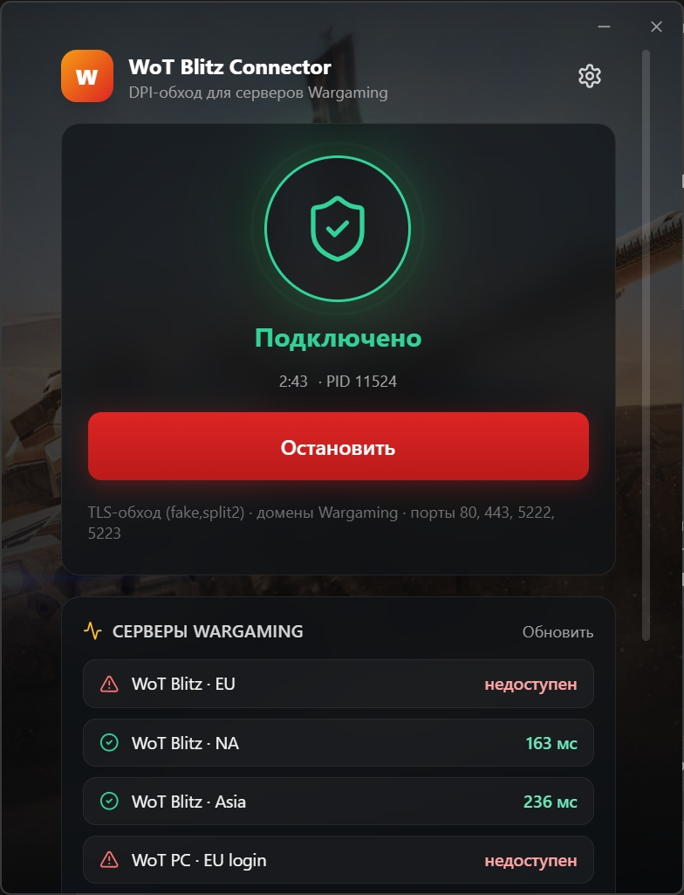

# WoT Blitz Connector

Лёгкий обходчик блокировок DPI для **World of Tanks Blitz** и **World of Tanks** на серверах Wargaming. Одна кнопка: включил — играешь. Магазин, ивенты, предметы, аватары — всё грузится сразу и без задержек.



**Автор:** [🌐 mixas.pro](https://mixas.pro) · [✈️ Telegram: mixaseth.t.me](https://mixaseth.t.me)

> Хотите так же смотреть YouTube, сидеть в Discord и на других сайтах без VPN?
> Используйте бесплатно полную версию [Zapret2](https://github.com/MixasV/zapret2-gui/tree/fix/graceful-exit-and-bridge-cooldowns)

⭐ **Пользуетесь программой — поставьте звёздочку репозиторию!** Это бесплатная поддержка и лучший способ сказать «спасибо».

## Как это работает

Внутри — движок [winws](https://github.com/bol-van/zapret) (zapret) + драйвер WinDivert. Программа запускает его с одной фиксированной стратегией, настроенной под серверы Wargaming:

- **QUIC и TCP-десинк** для доменов Wargaming (логин, API, магазин)
- **Десинк по IP-подсетям** игровых серверов (их трафик не содержит имени домена, поэтому по IP)
- **Голосовой чат (Vivox)** и Game Center

Список доменов и подсетей лежит в `bin/lists/` — правится любым текстовым редактором.

## Быстрый старт

1. Скачайте релиз (или соберите сами — ниже)
2. Запустите `Запустить.bat` — он попросит права администратора (нужны для WinDivert)
3. Нажмите «Подключиться» — в игре появится доступ к серверам Wargaming

Закрытие окна полностью завершает программу — никаких фоновых процессов и автозапуска.

## Сборка из исходников

Нужны: [Node.js](https://nodejs.org), [Rust](https://rustup.rs), Visual Studio Build Tools.

```powershell
npm install
npm run build
cargo build --release
```

Готовый exe: `src-tauri\target\release\wotblitz-connector.exe`. Запускайте `Запустить.bat` из корня — он сам найдёт бинарник и движок в `bin\`.

## Структура

```
wotblitz/
  bin/                  движок (winws.exe, WinDivert) и списки доменов
    lists/              списки доменов и IP-подсетей
  src/                  интерфейс (React)
  src-tauri/            бэкенд (Rust)
  Запустить.bat         запуск с правами администратора
```

## Что внутри

- Windows: Tauri 2 + Rust (tokio), фронтенд: React + TypeScript
- Списки доменов: Wargaming + Cloudflare/DoH, IP-подсети игровых серверов
- Проверка доступности серверов (EU/NA/Asia) прямо в окне

## Дисклеймер

Неофициальная утилита. **Не связана с Wargaming.net.** World of Tanks, World of Tanks Blitz и related логотипы — товарные знаки Wargaming.net. Программа не модифицирует игру — только обрабатывает сетевые пакеты. Используйте на свой страх и риск.

## Сторонние компоненты

| Компонент | Проект | Лицензия |
|---|---|---|
| `bin/winws.exe` | [zapret](https://github.com/bol-van/zapret) | [MIT](https://raw.githubusercontent.com/bol-van/zapret/master/docs/LICENSE.txt) |
| `bin/WinDivert.dll`, `bin/WinDivert64.sys` | [WinDivert](https://reqrypt.org/windivert.html) © basil | LGPL v3 / GPL v2 (на выбор) |
| `bin/cygwin1.dll` | [Cygwin](https://cygwin.com/) | LGPL v3 |
| `public/bg/*.jpg` | Арт World of Tanks Blitz | © Wargaming.net (только личное использование) |
